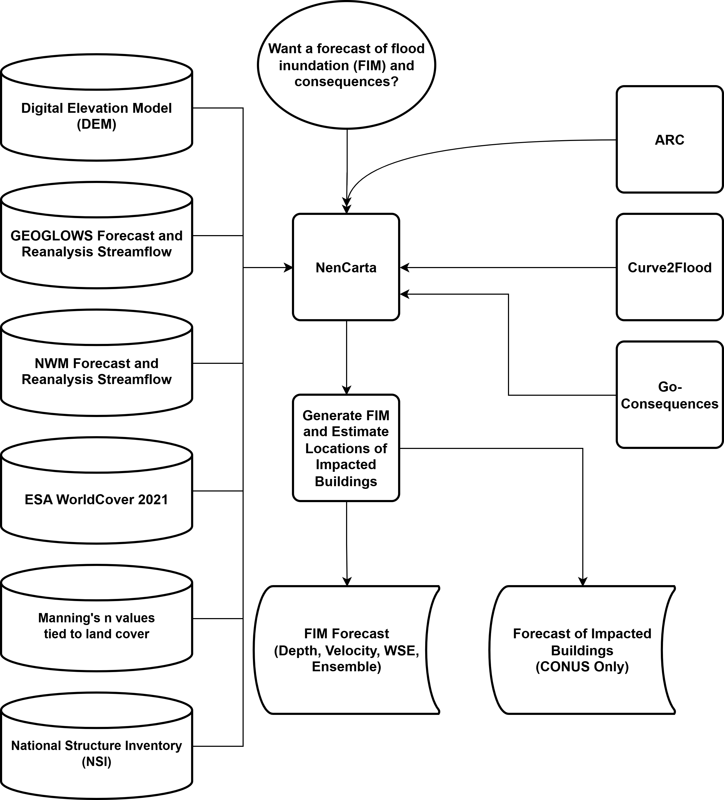

# About NenCarta
NenCarta makes riverine flood inundation maps from a DEM and a stream network, using the Automated Rating Curve (ARC) tool, Curve2Flood, and streamflow from the GEOGLOWS ECMWF Streamflow Service or the National Water Model. For the coterminous United States, NenCarta can then estimate direct flood consequences from the flood maps using Go-Consequences and the National Structure Inventory (NSI).

Here is an overview of how NenCarta produces flood inundation maps and performs consequence assessment.



# Documentation

The full documentation is on our [Read the Docs page](https://nencarta.readthedocs.io/en/latest/index.html), including [how it works](https://nencarta.readthedocs.io/en/latest/methods.html), [every setting](https://nencarta.readthedocs.io/en/latest/configuration.html) and [the Python API](https://nencarta.readthedocs.io/en/latest/api.html).

# Setting up NenCarta

With [conda](https://github.com/conda-forge/miniforge), in the folder this repository was cloned to:

```bash
conda env create -f environment.yaml
conda activate nencarta_py312
pip install --no-deps "git+https://github.com/MikeFHS/automated-rating-curve.git"
pip install --no-deps "git+https://github.com/MikeFHS/curve2flood.git"
pip install --no-deps .
flood-mapping -h
```

The two `git+` lines install ARC and Curve2Flood, in the versions NenCarta is tested with.

To compute economic consequences from the flood maps, install Docker (e.g. [Docker Desktop](https://www.docker.com/products/docker-desktop/)) and build the Go-Consequences image:

```bash
docker build --progress=plain --file Dockerfile.prod -t go-consequences:latest .
```

You should be set up now. Have fun you dirty animals!

# How to Run NenCarta

There are four ways to run NenCarta, which all take the same settings: the GUI, a JSON file, the command line, or Python.

## Graphical User Interface (GUI)

```bash
flood-mapping gui
```

## JSON file

```json
{
    "watersheds": [
        {
            "name": "example",
            "dem_dir": "C:/data/dems",
            "flowline": "C:/data/streams.gpkg",
            "output_dir": "C:/data/results",
            "floodmap_mode": "return_period",
            "return_periods": [2, 100]
        }
    ]
}
```

```bash
flood-mapping json "/path/to/your.json"
```

Add `--parallel --num_workers 8` to map several DEMs at once.

## Command line

Every JSON setting is also an option of the same name:

```bash
flood-mapping cli --name example --output_dir C:/data/results --dem_dir C:/data/dems --flowline C:/data/streams.gpkg --floodmap_mode return_period --return_periods 2 100
```

Run `flood-mapping cli -h` to see them all.

## Python

```python
from nencarta import process_watershed

process_watershed({
    "name": "example",
    "dem_dir": r"C:\data\dems",
    "flowline": r"C:\data\streams.gpkg",
    "output_dir": r"C:\data\results",
})
```
