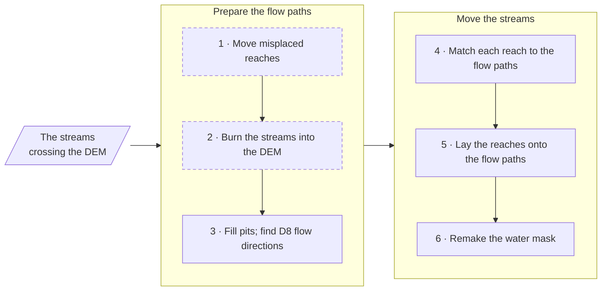
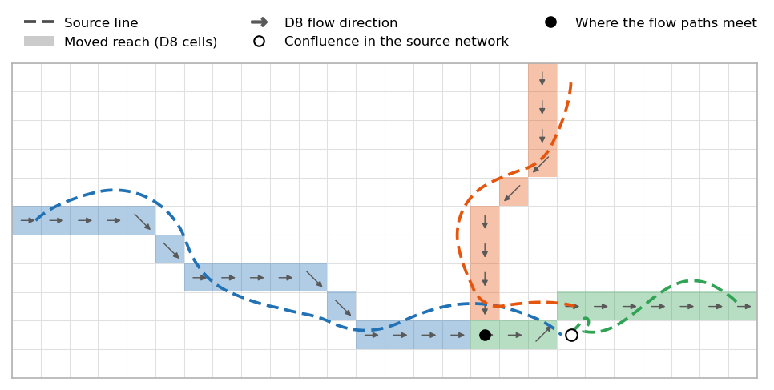
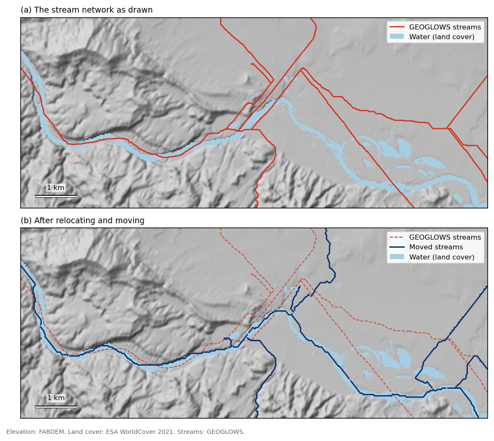
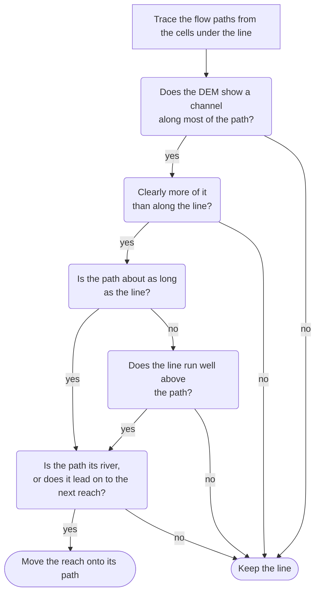
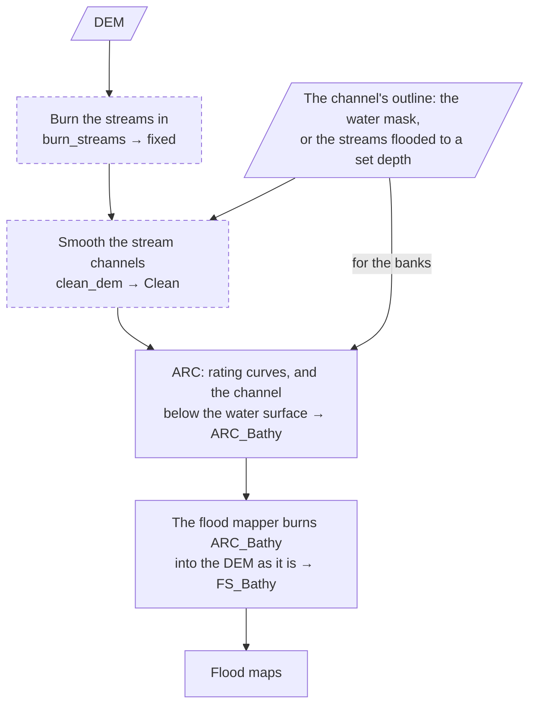
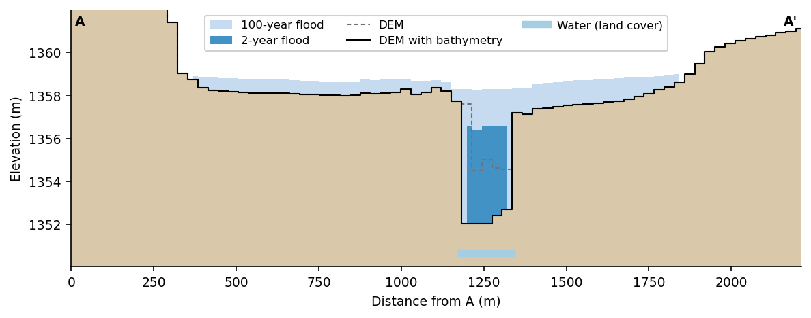
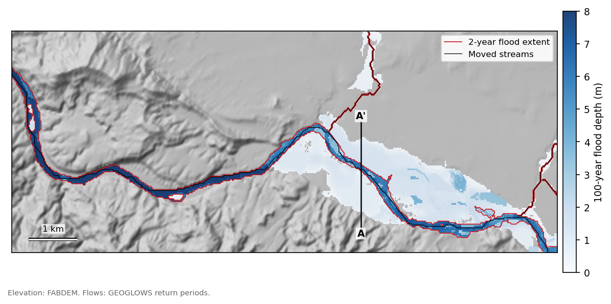
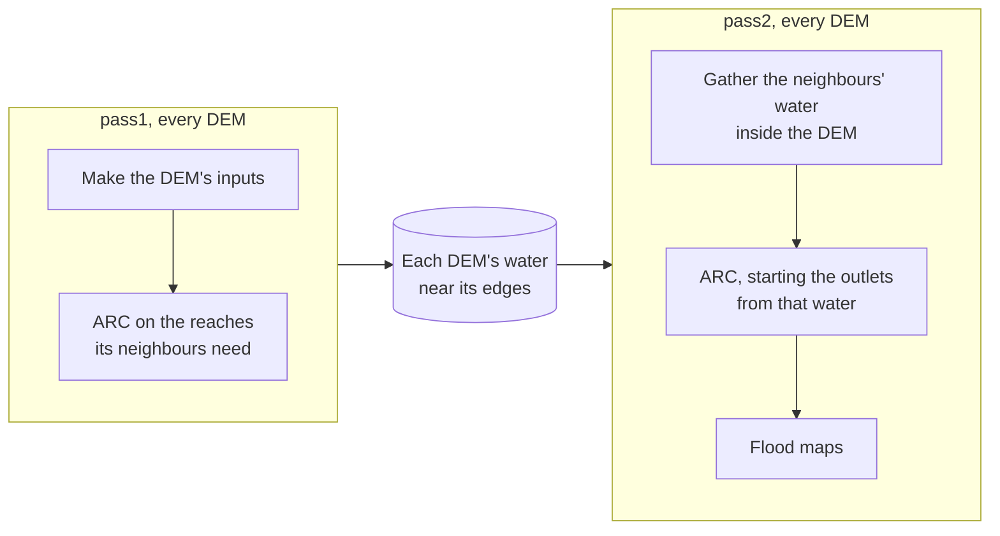

# How it works

This page explains how NenCarta gets from a DEM and a stream network to a flood
map: what it does to the streams, how it estimates the river bed, how the
flood maps are made, and how neighbouring DEMs' maps are made to meet.
[What a run does](usage.md#what-a-run-does) lists the steps, and
[Configuration reference](configuration.md) describes the settings named here.

The maps and cross section come from a run on the Colorado River near Loma,
Colorado, with GEOGLOWS streams and return period flows.

## Moving streams onto the DEM

ARC and the flood mappers follow each stream along the DEM's flow paths, from
cell to cell downhill (D8 flow directions). A stream network such as GEOGLOWS,
TDX-Hydro or NHD was drawn from another DEM, so its lines drift on and off
those paths. With `move_stream_network_to_thalweg`, NenCarta moves each
reach onto the flow path it follows:

Dashed steps are optional.

1. With `relocate_misplaced_streams`, the reaches the DEM shows are drawn off
    their river are moved onto it first (see [Relocating misplaced streams](#relocating-misplaced-streams)).
2. With `burn_streams`, the streams are burned into the DEM (`fixed`), so
    its flow paths follow them: each reach is lowered along its line, in 0.5 m
    steps that never rise downstream, starting no higher than the largest reach
    flowing into it. With `use_dem_derived_channel_mask`, the burn leaves a
    line where it runs on the water the DEM flattens (see
    [The channel a DEM shows](#the-channel-a-dem-shows)), and the line goes on down from there at the water's
    level; a line's end on the DEM's edge is still lowered, so the flow leaves
    there.
    Stair steps throw off the stream slopes
    ARC measures, so they are then smoothed into ramps, and so is water that the
    DEM shows in 0.5 m terraces, as FABDEM does: where two terraces meet, the
    water takes their mean, and in the middle of each it keeps its level. The
    water is lowered by up to 0.1 m toward the middle of the channel, farthest
    from the banks, and a line the burn lowered in it as low as the middle, so
    the flow keeps to the line; a line the burn left on the water is smoothed as
    the water around it. Along each line the smoothed DEM never rises, and keeps
    falling across water the DEM shows flat, so the flow can't run back up it.
    The burned DEM has no data in the `ocean`, so the lines end at the shore
    and the flow leaves the DEM there, as over its edge. Misplaced reaches
    (step 1) are moved, and the water mask made (step 6), with the sea off the
    DEM too. Before all this, a river is ended where it first reaches the sea:
    a reach starting in the sea, or below one that does, is left out, and a
    line running on out of the sea is cut there. A sea's polygon often reaches
    up an estuary, where such a reach has only the bank beside the channel on
    land, and would flood it as deep as the river.
3. A Priority-Flood fills the DEM's pits (`filled`), and the D8 flow
    direction of each cell (`flowdir`) is its steepest way down. Across flats, the ones
    filling leaves and the DEM's own, flow runs away from the higher ground
    around them and toward their outlets (Barnes et al. 2014), down their
    middles rather than along one edge. Both come from the burned DEM filled,
    with each line run down the fill, starting below all the reaches flowing
    into it, each where its line comes nearest the start (its end, at a
    junction). A line never rises, and is never above the fill, so it is the
    lowest way across the pools filling leaves. A line cut below the water the
    burn leaves at its level (toward a pit beside it, or below a reach flowing
    into it) would otherwise be dammed by that water: filling pools the line,
    and the flow crosses the pool and leaves the line where its rim is lowest,
    a reach away at times. Run down the fill, the line is cut through the water
    only where the fill rises along it, and only to the level its pool spills
    at, not to the line's lowest point: carried down the network, that point
    lowered whole canal networks on flat ground by metres. Each line cell is
    also low enough for the cell above to drain into it rather than onto the
    ground beside, by at most 1 m, so a line on water the DEM leaves lowest in
    its middle keeps the flow. ARC keeps the burned DEM as it is.
4. Each reach is matched to the nearby flow paths draining at least
    `new_strm_threshold_km2`, keeping the stretch that follows its line best.
    A river flowing in across the DEM's edge drains little within it, so its
    flow path from where it comes in counts as draining enough. It comes in at
    the lowest cell on the edge within two cells of where its line crosses: a
    line often crosses a cell or two off its river, on the bank, which would
    flood the land beside the river as if it were the river. A reach too little of which follows a flow path, such as a wide river whose
    flow path wanders across the water the DEM shows flat, is matched again
    with a search three times as wide. Each reach then meets the flow of the
    reach bringing it most of its water: it starts where that reach ends, or
    where that flow enters it, not up a smaller tributary or a hillside its
    line ran onto, which it would flood as deep as the river; and where that
    flow passes it by on its way to the reaches below, as down another branch
    of a braided river, it is moved onto that flow path.
5. The matched reaches are laid onto the flow paths from upstream down, each
    ending where the next starts. Where two flow paths meet but the streams
    don't, the stream network decides which carries on. A reach whose flow path
    runs a cell beside a bigger river's for three cells or more before the two
    meet ends where it comes beside it: a small gap above the confluence,
    rather than two lines along one river. With the `Curve2Flood-FLDPLNpy`
    mapper, `lakes` cut the network, and a reach flowing out of one starts
    below its last drop of 1 m or more a cell within 450 m of the lake, where
    the river below the outlet begins: on a dam's face or the lake's rim it
    would flood the valley below at nearly the lake's level. A river that keeps
    dropping like that below is a steep stream, and keeps its cells. A reach
    left with a single cell takes one from a neighbour, and a reach left with
    none gets a short flow path of its own near its line. So every reach with
    part of its line on the DEM, outside lakes, is in the moved streams, but
    for those below where their river enters the sea.
6. The water mask becomes the moved streams and the water connected to them:
    the land cover's, and with `use_dem_derived_channel_mask` the channel the
    DEM shows along them too (see [The channel a DEM shows](#the-channel-a-dem-shows)), the channel this DEM has
    even where the river has moved since. Where the mask outlines the river bed (see
    [bathymetry](#bathymetry)), a line no reach was moved onto, such
    as a relocated reach's old line, gets no river bed and doesn't flood. Nor
    does water more than 1 m above the river's level beside it on the DEM: a
    bar in a braided river, or a floodplain the imagery caught flooded, which
    the DEM shows dry, would otherwise be carved down to the river's bed. That
    level is the lowest of the stream cells within twice as far as the nearest
    one, each raised by its reach's slope for how far along the river it lies,
    so the water beside a steep river is compared with the river beside it, not
    with the river farther down. The water inside `lakes` is kept whatever its
    level: no stream runs in a lake FLDPLN's network is cut at, so a reservoir's
    water by its dam would be compared with the river below the dam, metres
    lower. A reach the mask has mostly a cell wide (more than half its stream
    cells have no water beside them) is a cell wide all along: patches of water
    that touch only such reaches' stream cells, and hold no lake water, are left
    out. A pond or a wet field beside a river the DEM and the imagery show no
    wider than a cell, would
    otherwise be carved as the river. Water that also touches a wider reach is
    that river's, though a narrow tributary's line runs into it, and stays.

Each moved reach keeps its ID, so its flows still apply, and is one unbroken
flow path; its downstream reach is the one its flow path drains into. The moved
streams are saved as `matched`, as lines and as a raster.

<figure markdown="span">
  
  <figcaption>A small synthetic example, moved by NenCarta. Each colour is one reach: its line as drawn (dashed) and the cells it was moved onto. The tributary joins the river where their flow paths meet, three cells above the confluence the stream network draws.</figcaption>
</figure>

### The channel a DEM shows

DEMs show their rivers' water differently: FABDEM and Copernicus flatten it to
whole half metres, USGS 3DEP flattens it to any height, and SRTM, NASADEM,
ASTER and AW3D30 store whole metres, so that most of their land is flat too.
With `use_dem_derived_channel_mask`, the channel along the streams is found
the same way on all of them, from the river's level beside each cell: the level
of the nearest stream cell, the lowest of the DEM within 60 m of it (a stream
may be drawn a cell or two off the water), averaged along the streams over
150 m. Within 1.5 km of a stream:

* **Flat water**: cells exactly as high as at least two of their neighbours, in
    patches of more than 6 cells, no more than 2 m above the river's level, on a
    DEM whose heights are rounded to a centimetre or finer. On one rounded more
    coarsely (GEDTM's 0.1 m, SRTM's whole metres) flatness says nothing. Flat
    water reaches no farther from the stream than twice the river's expected
    width (below), or 60 m along smaller rivers.
* **Low ground by the stream**: cells no more than 1 m above the river's level,
    within 1.5 times the river's expected width of the stream (1.1 m per square
    root of its drainage area in km²), along a river expected to be at least a
    cell wide. A narrower river's channel is its stream cells.

The channel is the flat water and the low ground, in patches touching a stream,
but on a DEM that flattens every river wide enough to show (FABDEM,
Copernicus) the flat water alone. Such a DEM leaves unflattened only the rivers
too narrow for it, and their low ground is the floodplain beside them. USGS 3DEP flattens 
only some of its
water, and there the flat water alone found little of it. Which DEM it is is
[`dem_flattens_rivers`](configuration.md#json-dem_flattens_rivers); left at
`auto`, the DEM's flat water by the streams says, by being mostly at whole half
metres or not. The burn, the smoothing and
relocation use the flat water alone: the low ground is measured from the lines
they burn or judge, so it would count a line as on its channel wherever it
runs. Relocation's flat water reaches as far from a line as it looks for the
river, whatever the river's width, since a misplaced line can lie far from its
water.

### Relocating misplaced streams

Burning puts each river where the stream network draws it, so where the network
is wrong, the burn cuts a new channel there and the river is mapped in the wrong
place. GEOGLOWS, for instance, draws some rivers straight across their
floodplain, or along the rim of their canyon. With
`relocate_misplaced_streams` (on by default), NenCarta looks for these reaches
on the unburned DEM, and moves them onto its flow paths before the burn.

<figure markdown="span">
  
  <figcaption>(a) GEOGLOWS draws the Colorado River straight across its floodplain, up to 1.5 km from its channel, and along the canyon's edge to the west. (b) Moved onto the DEM's flow paths before the burn, the streams follow the river.</figcaption>
</figure>

A line drawn on its river follows the DEM's flow paths, and a line drawn beside
it, up a bank or across a bar or a terrace, drains onto it: the flow paths from
the cells under a line meet in the channel it stands for. So for each reach, a
D8 flow path is traced from every cell under its line, and each cell counts the
paths through it. The reach's path ends at the most-counted cell nearest the
line's end, and runs upstream through the most-counted cells flowing into it.
The paths are traced within 500 m to 2.5 km of the line (further for bigger
rivers), and stop at a river draining more than twice as much as the reach.
Below a reach others flow into, the line's top cells drain down the valley side
to the river, so the path starts where it drains half of what flows in, and is
carried up the river from there. What flows in is what the source says, or what
the DEM's rivers drain near the line's start where that is less: on a fan, the
DEM can send some of the water down another channel.

Most lines are close to their river, and moving a line that is nearly right
costs more than it gains, so a reach only moves onto its path when the DEM
clearly shows the path is the river and the line isn't:

* **A channel along the path**: at least half of the path's cells are channel
    cells. A channel cell is on the water the DEM flattens near the lines' level
    (see [The channel a DEM shows](#the-channel-a-dem-shows)), or at
    least 0.3 m below both the cells two away from it along a row, column or
    diagonal, on ground that filling the DEM didn't raise. Across the flats
    filling leaves, flow paths run in straight lines that say nothing about where
    the river is.
* **Clearly more than along the line**: the share of the path's cells that are
    channel cells is at least 20 percentage points more than the line's. A line
    already on a channel stays where it is. A line on its river but for a short
    cut across the neck of a bend shares most of its cells with its path, so it
    also moves where its path follows the bend: at least 10% longer than the
    line, and where the two are more than 1.5 cells apart, at least 40 points
    more of the path's cells are channel cells than of the line's.
* **About as long**: the path is at least 90% as long as the stretch of line it
    stands for. A flow path following the same course as the line is up to 8%
    longer than it, so a shorter one cuts across meanders the DEM is too coarse to
    show. Unless the line runs a median of 1.5 m or more above the path (on the
    DEM before filling): a line that climbs a bank or a valley side and comes back
    is longer than its river without meandering, while meanders lie on the
    floodplain, about as low as a path cutting across them.
* **Its river**: the path drains at least half of what the reach does and ends
    near the line's end (within the distance the paths are traced), or it leads
    on into the reach it flows into: down its flow path, it reaches that reach's
    line or path. At an outlet, either will do. Across a flat fan, the DEM can
    carry a river some other way, leaving a gully near the top of its line the
    most counted; on a plateau, a river's top cells can drain off its far side,
    down a path that runs from the line away from the line's end; down a braided
    river, the flow paths carry the river down one branch, and those down the
    others drain little but lead on down them.

Then:

* A moved reach is carried down its flow path onto the line of the reach it
    flows into, or failing that onto the line of the reach below that one (down a
    braided river, one branch can bypass a short reach), and so is a reach kept
    where it was whose next reach moved. Where that doesn't get there, as when
    the flow path ends in a pit, runs down another branch or takes too long, the
    moved reaches keep their lines where their paths don't reach, so the network
    stays joined where the lines met: a moved reach keeps its line below where
    its path ends nearest it, down to the reach it flows into, and a moved reach
    that a reach flowing into it can't be carried onto keeps its line above where
    its path starts nearest it, up to the reaches flowing into it. Each is joined
    to its path by a straight stretch. A moved reach drawn as several lines
    becomes the path of its main stem; its stretches off the DEM keep their
    lines.
* A river flowing in across the domain's edge drains little within it, so the
    area the stream network gives it is added to the flow path from where it
    enters. Where it flows in on a flat level with the edge, as FABDEM's leveled
    water often is, filling drains the flat's upstream end back out across that
    edge; and a river along the edge can leave the domain and come back in. Its
    area is then added at the first cell whose flow path follows the river for
    1 km, and again wherever the river comes back in after that path leaves the
    domain.
* Where the DEM dams a river, as a gorge narrower than a cell can, the filled
    valley above may drain out some other way, such as back across the edge the
    river flows in over, and no flow path below carries the river. So before the
    DEM is filled, each line is followed downstream, over at most 5 reaches:
    where the DEM under it rises 40 m or more above a low and comes back down to
    it, and the DEM has no way between the two lows that climbs less than 40 m,
    the line is burned from one low to the other, falling evenly between them.
    Both lows must be where the line runs level, the cell above the first and the
    cell below the second within 1 m of it: the burn starts on the river above
    the dam, not in a pit, and runs on past any hump left at the dam's foot.
    A smaller rise is left: lines on hillsides and in towns cross ridges,
    quarries and buried channels that high.
* Streams without a drainage area (`area_km2_field` or `area_m2_field`) are
    left as they are.

The log says how many reaches moved, and the relocated network is saved as
`StrmShp_relocated` in the `STRM` folder, next to the original
`StrmShp`: compare the two to check them.

## Bathymetry

A DEM shows the water surface, not the river bed, so the channel below the
water is missing from it. Mapped on the DEM alone, a flow would have to rise
higher to pass, and the floods would be too big. ARC estimates the missing
channel for each stream cell, and the flood mapper burns it into the DEM the
flood maps are made on:

Dashed steps are optional. ARC sizes the channel for each reach's baseflow,
`specified_bathyflow_field` (the 2-year flow by default), between banks where
the water mask's water ends (see [The channel's outline](#the-channels-outline)). The flood mapper burns
ARC's raster into the DEM as ARC wrote it: ARC's bed wherever ARC carved a
channel, even a little past the water mask's edge, and the DEM everywhere else.
Nothing is clipped to an outline, and nothing beyond ARC's channel is filled
in. So the DEM the floods are mapped on has the channels ARC's rating curves
were worked out on, and each stream cell holds its rating curve's bed (the VDT
database's `Elev`). Unless ARC's `Bathy_Use_Banks` (in `arc_args`), the channel only ever lowers
the DEM. With `disable_bathymetry`, ARC builds only the rating curves, and the
flood maps are made on the DEM as it is.

<figure markdown="span">
  
  <figcaption>Cross section A–A' of the map below. The DEM (here with the streams burned in) is flat across the water; with the bathymetry, the channel is 2 to 3 m deeper. The 2-year flood stays in the channel, and the 100-year flood spreads across the floodplain.</figcaption>
</figure>

### The channel's outline

ARC puts each cross section's banks where the water mask's water ends, and the
DEM cleaner (`clean_dem`) smooths the channels inside an outline. The outline
is one of:

* **The water mask** (`use_specified_depth_for_bathy_mask` false): the moved
    streams and the water connected to them, the land cover's and, with
    `use_dem_derived_channel_mask`, the channel the DEM shows (see
    [The channel a DEM shows](#the-channel-a-dem-shows)), less the water more than 1 m above the river's level
    beside it (see [Moving streams onto the DEM](#moving-streams-onto-the-dem)).
* **The streams flooded to a set depth** (`use_specified_depth_for_bathy_mask`
    true, `specify_depths_for_bathy_mask`): each stream cell's water surface is
    its height on the DEM plus the depth, and each cell takes the average of the
    stream cells' water surfaces within `depth_mask_distance` (2000 m by
    default) of it, weighted by one over the distance squared. The cells below their average, in patches touching a stream, are
    the channel. Curve2Flood floods the streams ARC runs on, on the DEM ARC runs
    on, to the last depth just before ARC runs, and ARC is given that
    (`depth_mask`) in place of the water mask; the DEM cleaner's outline is
    flooded to the first.

With either outline, the flood mapper burns ARC's channel into the DEM as ARC
wrote it, and the water mask is what Curve2Flood's `Flood_Bathy_Mask` (in
`curve2flood_args`) floods.

The set depth's average takes in the river up and down stream and the
tributaries around, so across a flat valley floor it stands above the
floodplain, and even 0.1 m deep the outline can cover the whole valley. 

## Flood maps

ARC's rating curves give the depth, velocity and top width of the water at each
stream cell, for any flow. For each flow file, the flood mapper finds the water
surface elevation at each stream cell and spreads it across the floodplain: the
cells lower than the water surface flood. `Curve2Flood-FLDPLNpy` looks up which
cells each stream cell floods, and how deep, in the FLDPLN library it builds
first. The library is built with the bathymetry water mask, where there is one.
FLDPLN keeps a stretch of stream's water out of the river below it, which
floods the land downstream instead. The water mask makes that the whole
channel below, not just the one-cell stream line. Otherwise the water runs down
the channel beside the line and floods far downstream.

Each flow file gives four maps: flood extent, depth (the water surface minus the
DEM with bathymetry), water surface elevation and velocity. With several flows
per reach, such as a forecast's median, minimum and maximum, the extent map
gives the percentage of them that flood each cell.

<figure markdown="span">
  
  <figcaption>The 100-year flood's depth, and the 2-year flood's extent, from GEOGLOWS return period flows.</figcaption>
</figure>

## Neighbouring DEMs

Each DEM is mapped on its own, so where two meet, each maps the rivers crossing
between them from what it has, and the flood can stop at the line on one side
and carry on across it on the other: a seam. Three things cause most seams, and
each has its setting.

* **The DEM's edge.** Nothing beyond the edge is mapped: rivers start where
    they flow in across it, and floods stop at it. With `buffer`, each DEM is
    mapped `buffer_distance` larger,
    cut from `source_dems`, and its flood maps are cropped back to it, so the
    edge lies outside the map.
* **Cross sections cut off by the edge.** Near the edge, ARC's cross sections
    end where the DEM does, a wall where the ground would go on, so their water
    depends on where the DEM ends. DEMs whose buffers overlap give the same
    cell different water. ARC's `Drop_Edge_Sections` (in `arc_args`) drops the
    rating curves whose water, at their highest flow, reaches the edge (or
    comes within `Edge_Margin` of it); the stream cells around them still map their floods.
    It doesn't replace the buffer: where
    a seam's water comes from a river outside a DEM's buffer, only a wider
    buffer brings that river in.
* **Outlets at normal depth.** With ARC's `Standard_Step`, ARC works each river's
    water surface up from its outlet, which starts at normal depth. A river
    leaving a buffered DEM is cut off at its edge, where normal depth is often
    metres off, and the error backs up
    tens of kilometres. `outlet_exchange` starts it instead from the water the
    neighbouring DEMs have there, which their own outlets, farther downstream,
    set.

The outlet exchange runs every DEM twice, sharing a folder
(`outlet_exchange_dir`):

1. `pass1` makes each DEM's inputs, then runs ARC on the reaches its
    neighbours start their outlets from: those crossing the lines where the
    neighbours' buffers end inside it, `buffer_distance` in from each edge;
    every reach below them, since the standard step works up from the outlets;
    and the reaches flowing straight into those, since ARC starts each reach's
    bed from the lowest of its inflows'. Their water near those lines, at each
    flow of their rating curves, goes to `<DEM>_boundary_wse.parquet` in the
    shared folder, and the pass stops there.
2. `pass2`, once every DEM has done `pass1`, gathers the neighbours' water that
    falls inside the DEM into its `outlet_wse` file (ARC's `Outlet_WSE_File`).
    ARC starts each outlet from the point nearest its last cross section, if
    one is within 3 cells, and the others from normal depth. The DEM is then
    mapped as usual.
