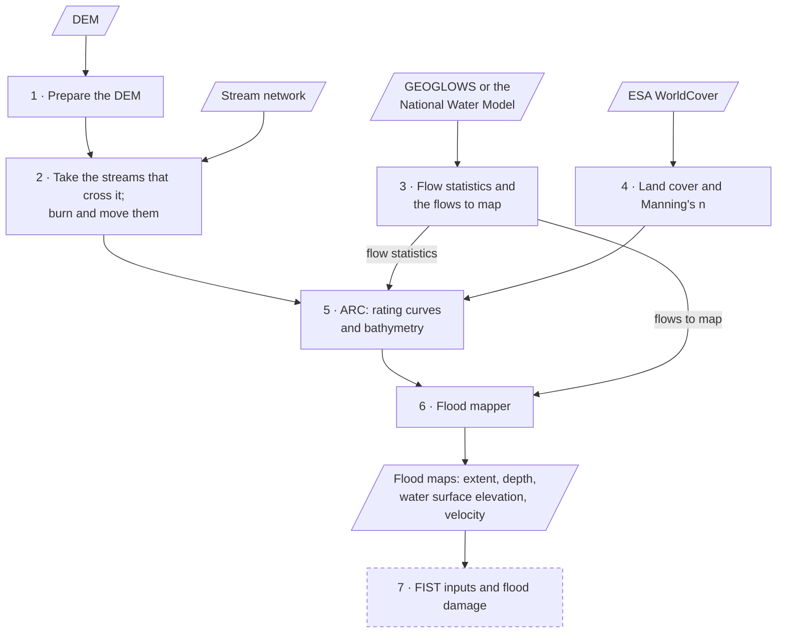

# Usage

NenCarta makes flood maps for each DEM you give it. You can run it from the GUI,
a JSON file, the command line or Python, and all four take the same settings
(see [Configuration reference](configuration.md)).

## What you need

* A DEM, or a folder of them.
* A stream network covering the DEM, with an ID for each reach and the ID of
    the reach downstream. The IDs must match the flow source: `LINKNO` and
    `DSLINKNO` for GEOGLOWS (its own or TDX-Hydro streams), `COMID` and
    `TOCOMID` for the National Water Model (NHDPlus streams). Other names can be
    given with `stream_id_field` and `downstream_id_field`.
* For the National Water Model, an API key (`nwm_api_key`).

## What a run does

For each DEM, NenCarta:



1. Prepares the DEM: uses it as it is, or cuts it from larger DEMs
    (`bbox`, `buffer`).
2. Takes the reaches that cross it, and can burn them into the DEM and move them
    onto its flow paths (see [Moving streams onto the DEM](methods.md#moving-streams-onto-the-dem)).
3. Gets each reach's flow statistics from GEOGLOWS or the National Water Model,
    and the flows to map: a forecast, return period flows, or your own.
4. Makes a land cover raster from ESA WorldCover, and gives each land cover a
    Manning's n.
5. Runs ARC, which builds a rating curve for every stream cell and estimates
    the bathymetry of the channel below the water surface.
6. Runs the flood mapper, which adds the bathymetry to the DEM and maps the
    flood extent, depth, water surface elevation and velocity.
7. Optionally writes inputs for FIST and estimates flood damage with
    Go-Consequences.

[How it works](methods.md) explains these steps, with figures. Files that already exist
are reused unless `overwrite` is set, so running again only redoes what is
missing. The outputs are described under [Output folders](configuration.md#output-folders).

## GUI

```bash
flood-mapping gui
```

The GUI has a field for every setting, in tabs that follow the run; hover over
a field to see what it does.

* **Inputs**: the watershed's name and output folder, the DEM (a file, a folder
    of DEMs, or one cut from source DEMs to a bounding box, optionally buffered),
    and the stream network and where its flows come from.
* **Preprocessing**: the flows (the flow statistics, and which flood maps to
    make: a forecast, your flow files or return periods), cleaning the DEM,
    moving and burning the streams, lakes, land cover, and the water mask.
* **ARC**: the cross sections, bathymetry, slopes, Manning's n, advanced
    settings (the standard step, valley cross sections and the DEM's edges)
    and ARC's outputs.
* **Mapping**: the flood mapper (with FLDPLN's settings when it is chosen) and
    the flood maps to write.
* **FIST** and **Go Consequences**: the inputs for FIST, and flood damage.
* **Run**: overwriting, compression, running in parallel, and where the outputs
    go, with a preview of the output paths.

A field only shows when it applies, e.g. the FLDPLN settings with the FLDPLN
mapper, and a hidden field isn't sent: it takes its default. Quotes pasted
around a path are dropped. **Validate** checks the settings, **Preview JSON**
shows them as a watershed dictionary, and **Start Simulation** runs them and
shows the log. The GUI remembers its fields between sessions.

## JSON file

A JSON file lists one or more watersheds:

```json
{
  "watersheds": [
    {
      "name": "example",
      "dem_dir": "C:/data/dems",
      "flowline": "C:/data/streams.gpkg",
      "output_dir": "C:/data/results",
      "floodmap_mode": "return_period",
      "return_periods": [2, 100]
    }
  ]
}
```

```bash
flood-mapping json my_run.json
```

A top-level `"parallel": true` (and `"num_workers"`) runs the DEMs in
parallel. `--parallel` or `--serial`, and `--num_workers`, override the
file:

```bash
flood-mapping json my_run.json --parallel --num_workers 8
```

## Command line

The `cli` command maps one watershed. Every setting is an option of the same
name:

```bash
flood-mapping cli --name example --output_dir C:/data/results --dem_dir C:/data/dems --flowline C:/data/streams.gpkg --floodmap_mode return_period --return_periods 2 100
```

Switches are turned on with `--<key>` and off with `--no-<key>`
(e.g. `--overwrite`, `--no-make_fist_inputs`), lists take several values,
and dictionaries take JSON (e.g. `--arc_args '{"Gen_Slope_Dist": 20}'`).
`flood-mapping cli -h` lists every option.

## Python

```python
from nencarta import process_watershed

if __name__ == "__main__":
    process_watershed({
        "name": "example",
        "dem_dir": r"C:\data\dems",
        "flowline": r"C:\data\streams.gpkg",
        "output_dir": r"C:\data\results",
        "floodmap_mode": "return_period",
        "return_periods": [2, 100],
    })
```

[Python API](api.md) describes the functions, and how to check settings
without running them.

## Which DEMs are mapped

* `dem_dir`: each DEM in it matching `dem_filter`, separately.
* `dem`: that DEM.
* `source_dems` with `bbox`: one DEM cut to the box.

## Which flows are mapped

* `forecast` (the default): the newest forecast, or the one issued on
    `forensic_forecast_date`. Each reach gets the median, minimum and maximum
    of its forecast peak flows.
* `return_period`: the 2- to 100-year flows in `return_periods`.
    GEOGLOWS, or a `CUSTOM` source.
* `user`: your flow files (`user_flow_files`).

When a flow file has several flows per reach, such as a forecast's median,
minimum and maximum, the flood extent map gives the percentage of them that
flood each cell; with a single flow, a flooded cell is 100.

GEOGLOWS covers the world. The National Water Model covers the United States,
with `NWM_short_range`, `NWM_medium_range` and `NWM_long_range` forecasts.

## Mapping neighbouring DEMs

Each DEM is mapped on its own, so where two DEMs meet, their flood maps can
disagree, resulting in a seam. Three settings make them agree better (see
[Neighbouring DEMs](methods.md#neighbouring-dems)):

* `buffer`: map each DEM `buffer_distance` larger, cut from `source_dems`, so
    the rivers flow in from outside it, then crop its flood maps back to it.
* ARC's `Drop_Edge_Sections` (in `arc_args`): leave out the rating curves
    whose water reaches the DEM's edge, where the edge cuts their cross
    sections off.
* `outlet_exchange`: start each river that leaves a DEM from the water its
    neighbours have there, instead of from normal depth. It needs `buffer` and
    ARC's `Standard_Step`, and runs every DEM twice: all of them with `pass1`, then
    all of them with `pass2`, with the same `output_dir` (or
    `outlet_exchange_dir`) and `buffer_distance`. `pass1` makes each DEM's
    inputs and the water its neighbours need, and `pass2` maps it:

```bash
flood-mapping cli --name tiles --output_dir C:/data/results --dem_dir C:/data/tiles --source_dems C:/data/tiles.vrt --flowline C:/data/streams.gpkg --buffer --arc_args '{"Standard_Step": true}' --outlet_exchange pass1
flood-mapping cli --name tiles --output_dir C:/data/results --dem_dir C:/data/tiles --source_dems C:/data/tiles.vrt --flowline C:/data/streams.gpkg --buffer --arc_args '{"Standard_Step": true}' --outlet_exchange pass2
```

Leave `overwrite` off for `pass2`, so it uses the inputs `pass1` made. The
watersheds of one JSON file run together, so they must all have the same
`outlet_exchange`.
